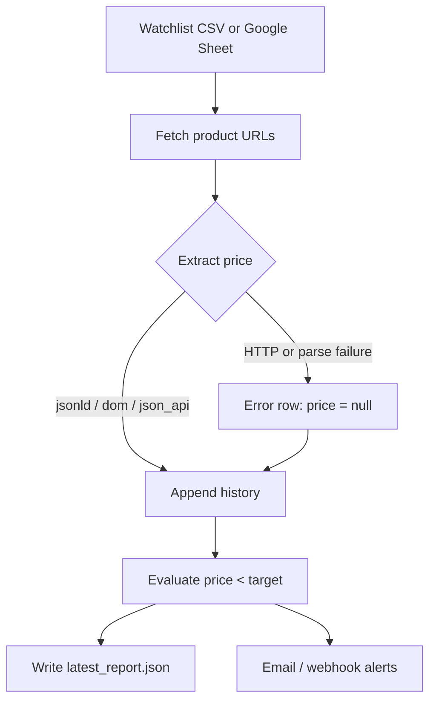

# Price Drop Monitor

[](https://github.com/flasheddy/price-drop-monitor/actions/workflows/ci.yml)

A small, self-hosted tracker for the products you actually watch. It reads a CSV or Google Sheet,
extracts one price per product with JSON-LD, CSS, or JSON API logic, appends history, writes a
schema-validated JSON report, and sends one consolidated alert when a price drops strictly below
your target.

- **Fail-closed:** a missing or unparsable price becomes an explicit error, never a guessed value.
- **Offline tests:** parsers, storage, alerts, and the pipeline run without network access.

## How it works



## Quickstart

Requires Python 3.11+ and [uv](https://docs.astral.sh/uv/).

```fish
git clone https://github.com/flasheddy/price-drop-monitor.git
cd price-drop-monitor
uv sync
cp data/watchlist.example.csv data/watchlist.csv
$EDITOR data/watchlist.csv
just run --send-alerts
just validate
```

`just run --offline` exercises the bundled fixtures without network access. Replace the template's
placeholder rows before a live run; personal data files are gitignored.

## Watchlist

| Column | Required | Example | Notes |
| :------------- | :------- | :-------------------------- | :------------------------------------------------ |
| `product_id` | yes | `garmin-edge-840` | Stable unique ID used in history and alerts. |
| `name` | yes | `Garmin Edge 840` | Human-readable name, up to 200 characters. |
| `category` | yes | `cycling_gear` | `cycling_gear`, `tech_hardware`, `software_deal`. |
| `url` | yes | `https://shop.example/item` | Must start with `http://` or `https://`. |
| `target_price` | yes | `399.00` | Alert only when the current price is lower. |
| `old_price` | no | `449.99` | Used to calculate savings. |
| `currency` | no | `USD` | Three-letter code; defaults to `USD`. |
| `source_type` | yes | `jsonld` | `jsonld`, `dom`, or `json_api`. |
| `fixture_file` | no | `cycling_garmin_edge.html` | Offline fixture only; leave blank for live use. |

```csv
product_id,name,category,url,target_price,old_price,currency,source_type,fixture_file
garmin-edge-840,Garmin Edge 840,cycling_gear,https://shop.example/garmin-edge-840,399.00,449.99,USD,jsonld,
```

Rows are validated with Pydantic; a malformed URL, invalid category, or non-positive target fails the run.

## Extraction

- **`jsonld`** resolves a schema.org `Product` from an object, root array, or `@graph`; `price` wins over `lowPrice`.
- **`dom`** reads `.product-card .price-current` (or `.price-current`), preferring `data-price` over text. Currency comes from `.price-currency`, then `$`/`€`/`£`, then the watchlist default.
- **`json_api`** expects an object with `price` and optional `currency` and `in_stock`.

If extraction fails, the row is stored with `status="error"`, `current_price=null`,
`triggered_alert=false`, and a non-empty `error_message`.

## Alerts

An alert fires only when `status == "ok"` **and** `current_price < target_price`. Equality does not
trigger, and error rows never trigger. All triggered items are sent as one message.

```fish
set -gx SMTP_HOST smtp.gmail.com
set -gx SMTP_USER you@gmail.com
set -gx SMTP_APP_PASSWORD your_app_password
set -gx ALERT_TO_EMAIL you@gmail.com
set -gx WEBHOOK_ALERT_URL https://ntfy.sh/your_private_topic
```

SMTP uses STARTTLS on port 587 by default. Webhooks receive one JSON POST with `text`, `content`,
and `alert_count`. Missing notification config is a no-op; report and history still persist.

## Schedule

Local cron is the simplest option for a personal machine:

```cron
0 8 * * * cd /path/to/price-drop-monitor && fish -c 'just run --send-alerts' >> data/cron.log 2>&1
```

For GitHub Actions, enable the schedule in `.github/workflows/price_monitor.yml`, then add a
`WATCHLIST_CSV` secret, or set `GOOGLE_SHEETS_SPREADSHEET_ID` and `GOOGLE_SHEETS_API_TOKEN` to use
a sheet. SMTP and webhook secrets use the names above. The workflow uploads data as a 30-day
artifact instead of committing personal data.

## Commands

| Command | Purpose |
| :----------------------- | :------------------------------------------------- |
| `just run` | Run live checks using `data/watchlist.csv`. |
| `just run --offline` | Run bundled fixtures with no network. |
| `just run --send-alerts` | Run live and dispatch configured alerts. |
| `just validate` | Validate `data/latest_report.json` against schema. |
| `just check` | Run Ruff, basedpyright, gitleaks, and pytest. |

## Notes

History is appended to `data/price_history.csv`; the latest snapshot is `data/latest_report.json`;
the Draft 2020-12 contract is `docs/price_report.schema.json`. Retailers may block server-side
requests or change markup: inspect `error_message` and update the source type or selectors. Respect
each site's terms of service; this project does not bypass CAPTCHAs, proxies, or anti-bot systems.

## License

MIT — see [LICENSE](LICENSE).
